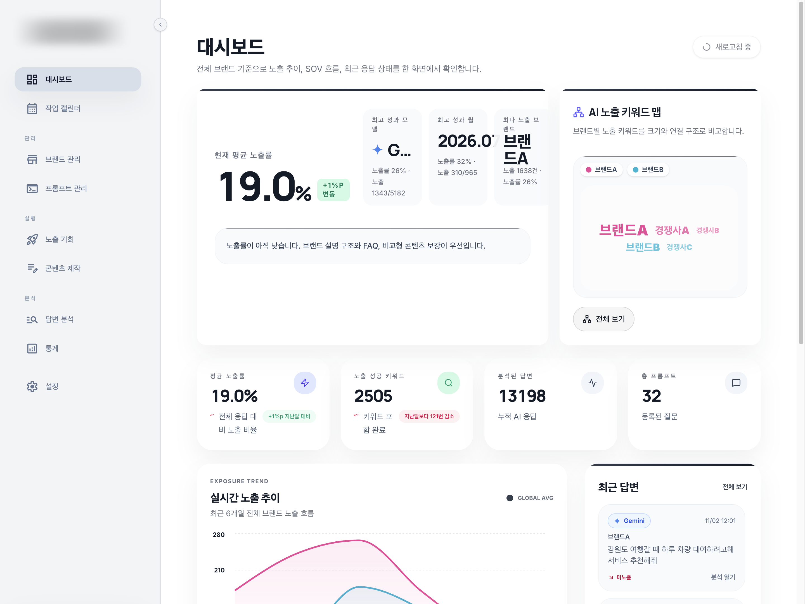
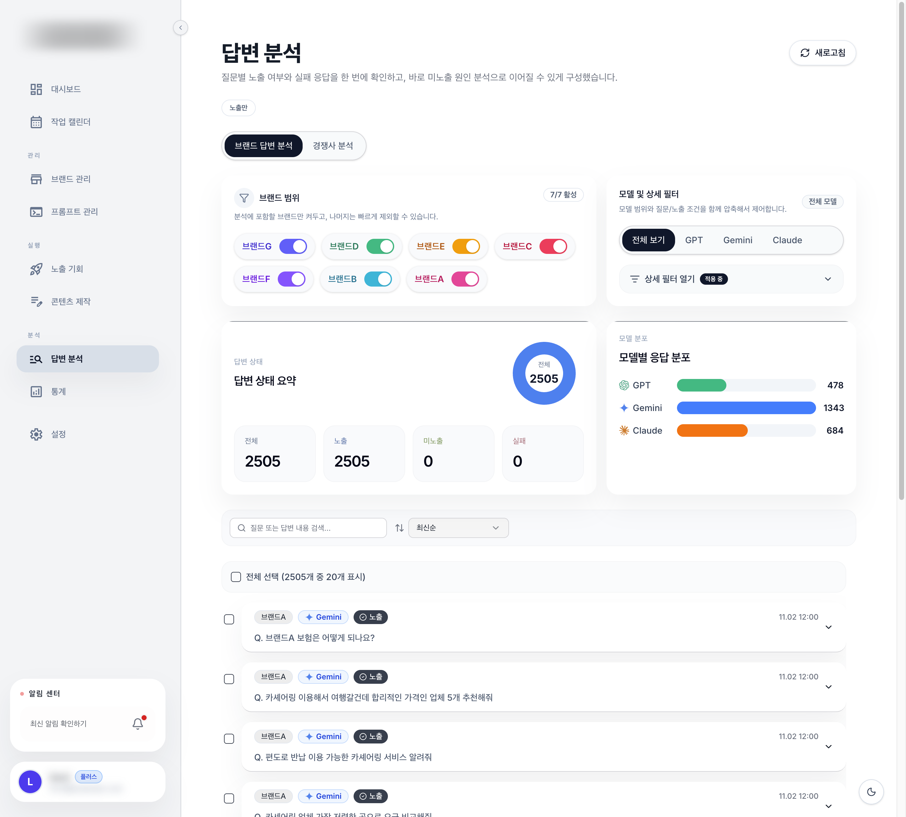
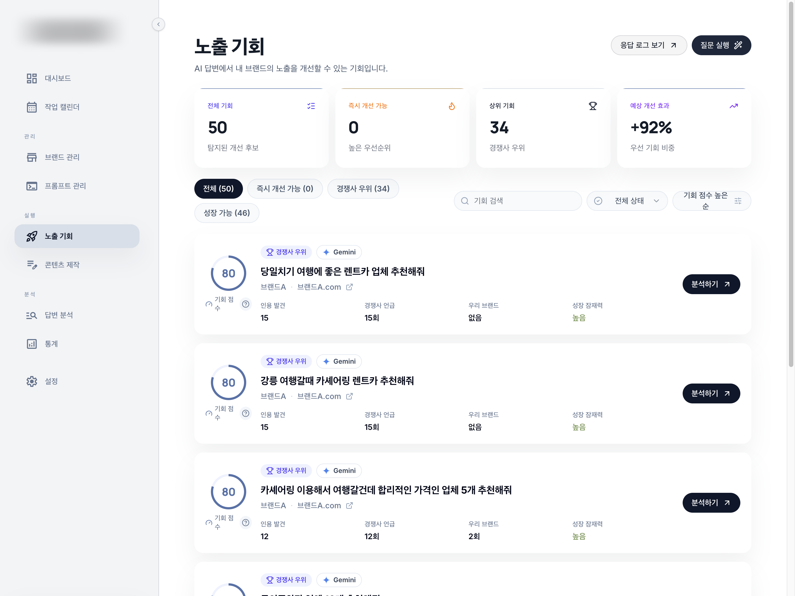

# geo-visibility-service

여러 브랜드의 AI 답변 노출을 정해진 질문으로 매일 측정하고 개선할 질문을 찾아주는 GEO 측정 서비스입니다.  
로그인해서 브랜드와 질문을 등록하면 ChatGPT, Gemini, Claude에 자동으로 질문하고 결과를 모아 보여줍니다.

> 실제 운영 중인 서비스라 소스와 서비스 이름은 공개하지 않습니다.  
> 아래 화면의 브랜드명은 가상 이름(브랜드A, 경쟁사A 등)으로 바꿨고 서비스 로고는 가렸습니다.

## 제작 배경

관리하는 브랜드가 여러 개라서 브랜드마다 질문을 따로 관리하고 모델별 결과를 매일 쌓아야 추세가 보였습니다.  
직접 물어보고 캡처하는 방식으로는 이 양을 감당하기 어려웠습니다.  
그래서 측정을 자동화하고 결과를 보는 데서 끝나지 않고 무엇을 고칠지까지 이어지도록 서비스로 만들었습니다.

## 역할

- **기획·지표 설계**: 직접 담당
  - 측정 지표(노출률, SOV, 브랜드 인용), 질문 유형, 화면 구성, 노출 기회 점수 기준 설계
- **개발**: 개발자 협업

## 주요 기능

| 메뉴 | 내용 |
|---|---|
| 대시보드 | 전체 평균 노출률, 모델·월·브랜드별 최고 성과, AI 노출 키워드 맵, 노출 추이 |
| 브랜드·프롬프트 관리 | 브랜드와 경쟁사, 브랜드별 질문 등록, 매일 정해진 시간에 자동 실행 |
| 답변 분석 | 질문별 노출·미노출·실패 상태, 모델별 응답 분포, 경쟁사 분석 |
| 노출 기회 | 경쟁사는 나오고 우리 브랜드는 빠진 질문을 점수로 정렬해 개선 후보로 제시 |
| 통계 | 기간·브랜드 기준 노출률, SOV, 브랜드 인용 비교와 CSV 내보내기 |

## 화면

### 대시보드

### 답변 분석

노출된 답변만 걸러 본 화면입니다.

### 노출 기회

## 관련 저장소

- [ai-answer-visibility-check](https://github.com/snh-builds/ai-answer-visibility-check): 같은 측정 방식을 가상 데이터로 공개한 분석 도구
- [content-performance-dashboard](https://github.com/snh-builds/content-performance-dashboard): 채널 성과와 AI 답변 노출을 함께 보는 실무 대시보드
